  <a href="https://yukariee.github.io/portfolio/">Portfolio</a> &nbsp;|&nbsp;
  <a href="https://basa-five.vercel.app/">BASA</a> &nbsp;|&nbsp;
  <a href="https://yukariee.github.io/sip-navigation/">SIP Navigation</a> &nbsp;|&nbsp;
  <a href="https://github.com/Yukariee?tab=repositories">All repositories</a>

## Hi, I'm Yukariee

I'm a first-year BS Information Technology student at National University–Fairview.

I like projects that start with a small, real problem: finding a room in a big building, or keeping a community library's records in order. I'm early in the journey, so most of what's here is school work and experiments. I build them, find out what breaks, and fix it.

## Featured projects

### BASA
**Better Arrangement and Systematic Access for Books and Resources**

A library management system for the Bagong Silang Community Library, built for our NSTP community project. It's designed so library officers can log in, keep a catalog of books, and record borrowing, returns, and overdue items.

It's the first thing I've built with a real database behind it, and the first thing I've deployed for people who will use it. That pushed me to think about simple screens and clear steps, not just working code.

**Status:** in active development &nbsp;|&nbsp; **Built with:** React, Vite, Supabase, Vercel
**[Live demo](https://basa-five.vercel.app/)** &nbsp;|&nbsp; Source: private repository for now

### SIP Navigation
**Recognized with Best in SIP**

A web-based indoor navigation system with pathfinding and floor-by-floor directions for a school campus. This was my Science Investigatory Project in senior high school.

Getting lost indoors is a surprisingly ordinary problem, and this was my first time turning a research question into something people can actually open and try.

**Built with:** HTML, CSS, JavaScript
**[Try it](https://yukariee.github.io/sip-navigation/)** &nbsp;|&nbsp; **[Source](https://github.com/Yukariee/sip-navigation)**

## More of what I've built

| Project | What it is |
| :-- | :-- |
| **[HASC 3D Viewer](https://yukariee.github.io/hasc-viewer/)** [source](https://github.com/Yukariee/hasc-viewer) | A 3D model of the school layout you can explore in the browser, made to go with the indoor navigation project. Built with HTML, CSS, and JavaScript around a single `.glb` model. |
| **[SmartSIP Navigation](https://yukariee.github.io/intcomp-activity/)** [source](https://github.com/Yukariee/intcomp-activity) | A concept prototype for an Interactive Computing class activity. It extends SIP Navigation with accessibility routing, alternative routes, and route preferences. Some features are simulated, and the site says so. HTML, CSS, vanilla JavaScript. |

**Smaller experiments and school work**

- **Arduino light alert:** a small circuit using an LDR, an LED, and a buzzer to practice reading a sensor and reacting to it in code.
- **STEM Club research:** a group study of STEM students' interests and needs, aimed at a more responsive STEM Club.
- **ConnectGlobal:** a concept for a global SIM service, developed for a school activity.

## Tools

<table>
  <tr>
    <td>Most used</td>
    <td></td>
  </tr>
  <tr>
    <td>Learning through BASA</td>
    <td></td>
  </tr>
  <tr>
    <td>Getting started with</td>
    <td></td>
  </tr>
</table>

I also edit videos in CapCut. None of this is a claim to be an expert; the rows show roughly how much time I've spent with each.

## Milestones

- Graduated from senior high school with High Honors
- Best in SIP for SIP Navigation
- Published school projects online with GitHub Pages
- Deployed my first database-backed web app (BASA, still in progress)

## Off the keyboard

I play guitar and like working out music ideas, and I edit videos for fun. It's the same habit as the code: keep practicing, keep trying things.

<a href="https://yukariee.github.io/portfolio/">See the full portfolio</a>

