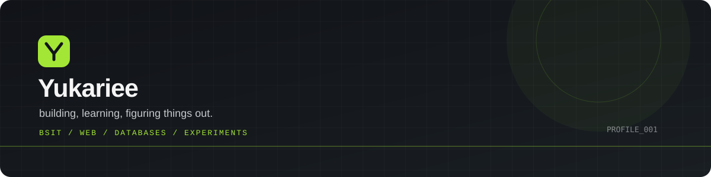

 

**BSIT student · curious builder · creative problem-solver**

I learn by making things, breaking things, and figuring out why they work.

[Portfolio](https://yukariee.github.io/portfolio/) · [GitHub](https://github.com/Yukariee) · [SIP Project](https://yukariee.github.io/sip-navigation/)

---

### A little about me

I'm a BSIT student exploring software, web development, hardware, and the space between technology and everyday problems. I like projects that give me something real to figure out—not just something to submit.

Right now, I'm building my fundamentals and learning to take ideas from **“what if?” to a working project**. Still learning, still experimenting, and trying to understand the *why* behind the code.

### Things I've built

<table>
<tr>
<td width="50%" valign="top">

**01 / BASA — Better Arrangement and Systematic Access for Books and Resources**  
A library management system built for our NSTP community library project. It helps officers organize book records and track borrowing/returns, including expected return dates and overdue status. This one matters to me because I designed and deployed a working database-backed app for the first time.

**Stack:** Web app · database · Vercel

**[Live demo](https://basa-five.vercel.app/)**

</td>
<td width="50%" valign="top">

**02 / HASC Navigation — 3D Viewer**  
An interactive browser-based 3D model viewer made for a school indoor-navigation project. It lets visitors explore a visual representation of the navigation environment.

**Focus:** 3D visualization · web development

[Open the viewer](https://yukariee.github.io/hasc-viewer/) · [Source code](https://github.com/Yukariee/hasc-viewer)

</td>
</tr>
<tr>
<td width="50%" valign="top">

**03 / SIP Navigation**  
My Senior High School Science Investigatory Project, recognized with **Best in SIP**. The project explores web-based indoor navigation with pathfinding and floor-by-floor navigation for a school campus.

**Focus:** Research · problem-solving · web development

[Try the project](https://yukariee.github.io/sip-navigation/) · [Source code](https://github.com/Yukariee/sip-navigation)

</td>
<td width="50%" valign="top">

**04 / Interactive Computing Activity**  
An early BSIT web activity and my first experience publishing a project as a live website using GitHub Pages.

**Focus:** HTML · CSS · JavaScript · deployment

[Open the site](https://yukariee.github.io/intcomp-activity/) · [Source code](https://github.com/Yukariee/intcomp-activity)

</td>
</tr>
</table>

<strong>Other experiments & school work</strong>

- **Arduino light-sensing alert** — a small circuit using an LDR, LED, and buzzer to explore sensor readings and conditional logic.
- **STEM Club research** — a group research study about STEM students' interests and needs for a more responsive STEM club.

### My toolkit

  

These are tools and technologies I've used or explored—not a claim that I'm an expert in all of them. I'm especially interested in getting better at programming fundamentals, web apps, databases, and practical automation.

### A few milestones

- Graduated Senior High School **with High Honors**
- Received **Best in SIP** recognition for my Science Investigatory Project
- Published school projects online with GitHub Pages
- Built and deployed a database-backed library system for our NSTP community project

### Beyond the code

Outside IT, I play guitar, explore music ideas, and edit videos with CapCut. I like learning by doing, whether that's a school project, a new tool, or something I got curious about on my own.

---

*Not an expert yet. Just building, learning, and keeping track of the progress.*

**[Explore my portfolio →](https://yukariee.github.io/portfolio/)**

